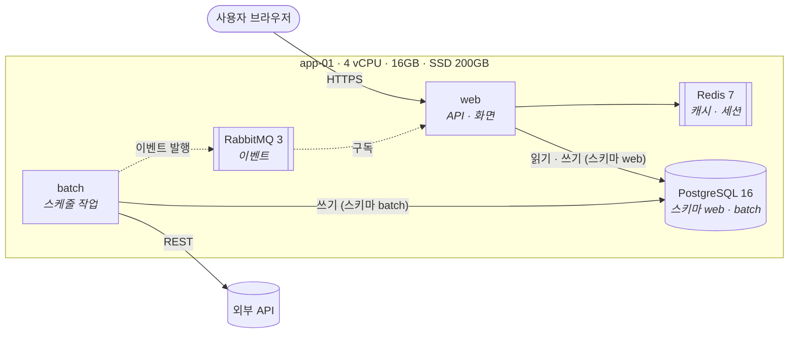

# 시스템 구성

> 상태: 초안

| 항목 | 내용 |
|---|---|
| 근거 | <범위 결정 · 요구사항 · 데이터 설계 문서 링크와 ID> |
| 읽는 법 | 단계마다 구성도 하나 + 서버 사양 표 하나. 그림의 이름은 아래 표의 이름과 같다 |

## 1. 단계 한눈에

| 단계 | 목표 | 추가 · 바뀌는 것 | 서버 |
|---|---|---|---|
| 1차 | <끝까지 동작하는 최소 구성> | <서비스 · 저장소 목록> | <서버 1대> |
| 2차 | <늘리는 이유: 부하 · 분리 · 이중화> | <추가되는 것만> | <서버 n대> |

## 2. 1차 구성

| 구성 요소 | 종류 | 버전 | 역할 | 연결 (방식 · 대상) | 서버 |
|---|---|---|---|---|---|
| web | 서비스 | <언어 · 프레임워크> | <한 줄> | DB 스키마 web (읽기 · 쓰기) · Redis · MQ 구독 | app-01 |
| PostgreSQL | 저장소 | 16 | <한 줄> | 스키마 web · batch | app-01 |
| Redis | 미들웨어 | 7 | 캐시 · 세션 | web | app-01 |

| 서버 | 용도 | CPU · 메모리 · 디스크 | OS | 위치 | 근거 (예상 부하) |
|---|---|---|---|---|---|
| app-01 | 서비스 · 저장소 같이 | 4 vCPU · 16GB · SSD 200GB | <OS> | <클라우드 · 사내 · NAS> | <동시 사용자 · 일일 건수 · 데이터 증가량> |

## 3. 2차 구성

1차와 달라지는 것만 그린다 (분리 · 추가 · 이중화). 바뀌지 않는 구성 요소는 이름만 둔다.

## 변경 이력

| 날짜 | 내용 | 작성 |
|---|---|---|
| <YYYY-MM-DD> | 최초 작성 | <역할> |
