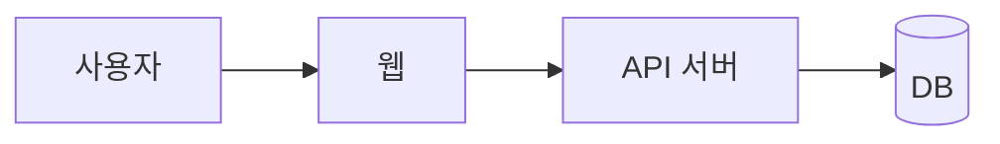
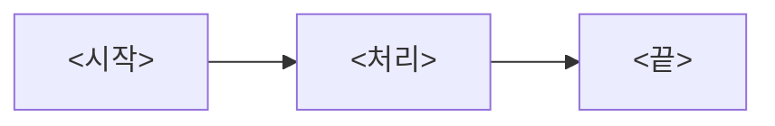

# 프로젝트 개요

> 상태: 초안

## 범위

<이 프로젝트로 해결하려는 문제와 기대 효과를 2~3줄로>

| 구분 | 내용 |
|---|---|
| 포함 | <이번에 만드는 것> |
| 제외 | <이번에 만들지 않는 것과 그 이유> |

## 구성

| 서비스 | 하는 일 |
|---|---|
| <웹> | <한 줄> |
| <API 서버> | <한 줄> |

## 핵심 흐름

## 핵심 결정

| ID | 결정 |
|---|---|
| <DEC-001> | <한 줄. 자세히는 [05-decisions/](../05-decisions/)> |

## 미결

정할 것은 [미결 목록](open-questions.md) 한 곳에 모은다.

## 이해관계자

| 역할 | 담당 영역 | 결정 권한 |
|---|---|---|
| <기획> | <요구사항 정의> | <요구사항 확정> |
| <개발> | <구현> | <기술 방식> |
| <고객사 현업> | <업무 검수> | <업무 규칙 확정> |

## 일정

| 단계 | 기간 |
|---|---|
| <분석> | <YYYY-MM-DD ~ YYYY-MM-DD> |

## 변경 이력

| 날짜 | 내용 | 작성 |
|---|---|---|
| <YYYY-MM-DD> | 최초 작성 | <역할> |
